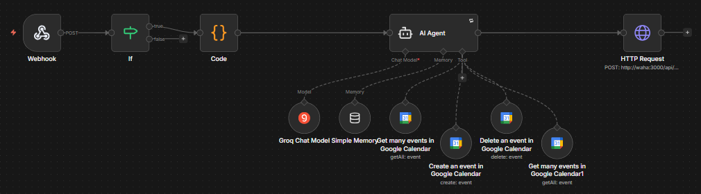
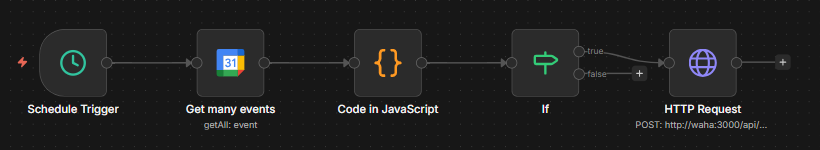
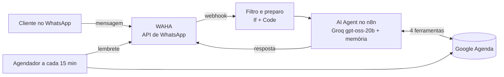

# Agente de agendamento para barbearia (n8n + WhatsApp + IA)

Agente de IA que atende clientes de uma barbearia pelo WhatsApp: entende o pedido em linguagem natural, consulta os horários livres, agenda, cancela e impede agendamento duplicado no Google Agenda. Um segundo fluxo envia lembrete automático cerca de 1 hora antes de cada horário.

Criado em março de 2026 (fluxos de 26/03 a 01/04/2026). Este repositório publica a versão final, sem chaves nem dados pessoais.

## Demonstração

**Fluxo do agente:** o webhook recebe a mensagem do WhatsApp, o filtro e o código preparam os dados, e o AI Agent usa o modelo da Groq, a memória e 4 ferramentas do Google Agenda antes de responder pelo WAHA.

**Fluxo de lembretes:** a cada 15 minutos, busca os próximos horários, separa os que começam em cerca de 1 hora e envia o lembrete pelo WhatsApp.

## O que ele faz

- Responde pelo WhatsApp, com memória das últimas 8 mensagens de cada cliente
- Identifica o serviço mesmo em linguagem informal ("quero cortar o cabelo" = Corte)
- Consulta a agenda antes de qualquer ação e permite um agendamento ativo por número
- Mostra só horários livres, dentro do funcionamento e nos próximos 7 dias
- Cancela pelo número do cliente, depois de confirmar
- Envia lembrete automático entre 45 e 75 minutos antes do horário, sem repetir

## Arquitetura

| Parte | Tecnologia |
| --- | --- |
| Orquestração | n8n em Docker, com PostgreSQL |
| Modelo de linguagem | Groq, modelo openai/gpt-oss-20b, temperatura 0.2 |
| WhatsApp | WAHA (WhatsApp HTTP API) em Docker |
| Agenda | Google Calendar (OAuth2) |

### Ferramentas do agente

| Ferramenta | Para que serve |
| --- | --- |
| Buscar eventos do dia | Ver horários ocupados antes de oferecer opções |
| Buscar eventos do cliente | Ver se o número já tem horário ou achar o evento para cancelar |
| Criar evento | Agendar 45 minutos com nome, telefone e serviço |
| Apagar evento | Cancelar o horário do cliente |

## Decisões

- Regra de um agendamento ativo por número, sempre conferida na agenda e nunca na memória da conversa, para evitar duplicidade.
- Telefone vindo do próprio WhatsApp, nunca digitado pelo cliente, para o agente não inventar números.
- Temperatura baixa (0.2) e prompt com regras explícitas de datas e fuso horário, para evitar agendamentos em data ou horário errados.
- Lembrete marcado no próprio evento para não ser enviado duas vezes.

## Como rodar

1. Copie `.env.example` para `.env` e preencha.
2. `docker compose up -d`
3. Abra http://localhost:5678, crie sua conta e importe os arquivos da pasta `workflows`.
4. Configure as credenciais da Groq e do Google Calendar no n8n e troque `SEU_CALENDAR_ID` pelo ID da sua agenda.
5. No WAHA (http://localhost:3000), conecte um número e aponte o webhook para `http://n8n:5678/webhook/waha`.
6. No nó If, troque `5511999999999@c.us` pelo número liberado para testes.

## Limitações

- Testado com um número de teste liberado no filtro; não foi colocado em produção com clientes reais.
- Sem métricas automáticas de acerto. A evolução disso está no projeto Entrega Clara, com evals.

## Próximos passos

- Avaliar o agente com um conjunto de mensagens de teste e medir a taxa de acerto
- Painel de agendamentos e cancelamentos por dia
